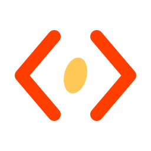

# Husk

<p align="center">
  
</p>

Svelte for .NET. No Node.

I wanted to write Svelte components in an ASP.NET Core app without putting a second toolchain on
every laptop and build server. Husk runs the Svelte compiler inside `dotnet build`, in an embedded
V8, so it does exactly that. You save a component, `dotnet watch` reloads the page, and
`dotnet publish` ships plain JavaScript and CSS.


> [!NOTE]
> Husk is a preview. The latest release is `0.1.0-preview.6`, and the API can still change.

## Try it

You need the .NET 10 SDK. In a web project:

```sh
dotnet add package Extrode.Husk.Build --version 0.1.0-preview.6
dotnet add package Extrode.Husk.AspNetCore --version 0.1.0-preview.6
```

Put `PrivateAssets="all"` on the `Extrode.Husk.Build` reference (it is a build tool, not app
code), then add one line to `Program.cs`:

```csharp
builder.AddHusk();   // recompiles on save; does nothing outside Development
```

Write `wwwroot/App.svelte`, a `main.ts` that mounts it and an `index.html` with
`<script type="importmap" data-husk></script>`, and run `dotnet watch`. The
[step-by-step guide](docs/01-getting-started/first-app.md) has every file.

Husk's build runs inside [Pare](https://github.com/extrode/pare)'s; `Extrode.Husk.Build` brings
`Extrode.Pare.Build` in, so there is nothing to add for it.

## What you get

| You do | What happens |
|---|---|
| `dotnet build` | `.svelte` files become ES modules, with source maps and one `husk.css`, under `obj/` |
| save a component under `dotnet watch` | it is recompiled in the running app and the page reloads |
| `dotnet publish` | the site ships compiled, hashed files and no sources |
| write bad Svelte | the build fails: `App.svelte(4,3): error HUSK100: ...`, like a C# error |

TypeScript works in components (`<script lang="ts">`, handled by Svelte) and in `.svelte.ts` rune modules
(Pare strips the types). The compiler output is checked byte for byte against Node running the same
Svelte (5.57.3), so you get what Svelte gives you.

## What it costs

- The build package is about 6 MB (compiler plus Svelte). It depends on Microsoft's V8 native
  packages for six platforms (77 MB, shared across Husk versions). Both are restored once per
  machine and none of it ships with your app.
- There is no bundler. The browser loads many small modules through an import map.
- Husk compiles components. It is not SvelteKit: no router, no server rendering yet.
- The build machine has to be Windows, macOS or glibc Linux, x64 or arm64. The app you publish
  runs anywhere.

## Documentation

The docs site is at [husk.extrode.com](https://husk.extrode.com). The same pages are in
[`docs/`](docs/00-overview/README.md):

- [Why Husk](docs/00-overview/why-husk.md)
- [Your first app](docs/01-getting-started/first-app.md)
- [What the build produces](docs/02-guides/what-the-build-produces.md)
- [Husk in plain words](docs/02-guides/husk-in-plain-words.md)
- [MSBuild reference](docs/03-reference/msbuild.md) and [error codes](docs/03-reference/error-codes.md)

## Building from source

```sh
dotnet build Husk.slnx
dotnet test --solution Husk.slnx
scripts/pack-local.sh                       # packs into tmp/feed
dotnet watch --project samples/svelte-app   # the sample app
```

Third-party licenses ship in the build package: [NOTICE](src/Extrode.Husk.Build/NOTICE.md).

## License

Husk is under the Islamic Software License, Permissive (ISL-P) 1.2, with the Output Exception
(ISL-OE) 1.2, the same terms as Pare. The exception means you can ship what Husk generates inside
your own app. These are source-available licenses with ethical restrictions, not OSI-approved
open source. See [LICENSE.md](LICENSE.md) and [NOTICE.md](NOTICE.md). Svelte, ClearScript and V8
keep their own MIT and BSD licenses.

## Contributing

Read [CONTRIBUTING.md](CONTRIBUTING.md). Security reports go through GitHub's private
vulnerability reporting: see [SECURITY.md](SECURITY.md).

The repository also holds its working notes (`work/`, `docs/specs`, `docs/decisions`), and
`AGENTS.md` for coding agents.
