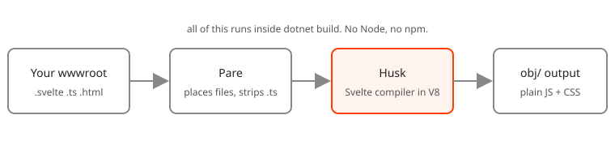

# Husk in plain words

Everything you need to use Husk, without the internals.

## What happens when you build

1. MSBuild finds your `.svelte`, `.svelte.ts` and `.html` files under `wwwroot`.
2. Husk starts a small JavaScript engine (V8) inside the build and loads the Svelte compiler into it.
3. Each component is compiled to an ES module, a source map and some CSS. Plain `.ts` files are stripped of their types.
4. The results are written under `obj/`, with a content hash in the name (when `HuskHashNames` is on, the default outside Debug), and served as static web assets at the path of the source file.
5. Your `index.html` gets an import map that tells the browser where `svelte` and your modules are.

That is all. The browser runs the output as it is: no bundle, and no Husk code at run time.

## What happens when you save

With `builder.AddHusk()` in Development, the running app watches your files. A saved component is compiled again in the same process, the engine is already warm, and `dotnet watch` reloads the page. If the save has an error, it is logged and the browser keeps the last good version.

Outside the Development environment, `AddHusk()` does nothing. The compiled files were already made by the build.

## Words you will meet

| Word | What it means here |
|---|---|
| Component | A `.svelte` file. |
| Rune module | A `.svelte.ts` or `.svelte.js` file that uses `$state` and friends outside a component. |
| Import map | A block in your HTML that maps `svelte` and `./App.svelte` to real URLs. Husk fills it in. |
| Marker | The empty `<script type="importmap" data-husk>` in your page. |
| Pare | The other half. It decides where compiled files go, serves and publishes them, and strips TypeScript. |
| Static web asset | An ASP.NET Core feature: files served from `obj/` as if they sat in `wwwroot`. |

## Pare, the part you should know

Husk is built on [Pare](https://github.com/extrode/pare), a TypeScript stripper and build for .NET. You never call it, but three things follow from it:

- **You reference `Extrode.Pare.Build` yourself**, with `PrivateAssets="all"`. NuGet imports build targets only for direct references. Without it the build stops with `HUSK002`.
- **TypeScript is stripped, not checked.** Types are erased and nothing complains about a type error. Run `tsc --noEmit` in your editor or CI if you want checking. Some syntax cannot be erased (an `enum`); the build reports it as a `PARE1xx` error.
- **There is no bundling or minifying.** Pare does neither, and Husk does not add them.

## Questions

**Does it need Node anywhere?** No. Not to build, not to run, not in CI.

**Is the output the same as Vite's?** The compiler output is the same as Node running Svelte 5.57.2, checked byte for byte. What differs is that there is no bundle: modules load one by one.

**Why 85.2 MB?** It carries V8 for Windows, macOS and Linux on x64 and arm64. It is restored once per machine and is not part of your published app.

**Can I use it on Alpine?** You cannot build there (`HUSK001`). The published app runs anywhere, so build on Debian or in a glibc container.

**Which browsers?** The output is tested in Chrome, Firefox and Safari.

**Does it do SvelteKit?** No. Routing and server rendering are not part of Husk yet.

**Where do I report a problem?** On GitHub; there is a bug template. For security, use private vulnerability reporting.
